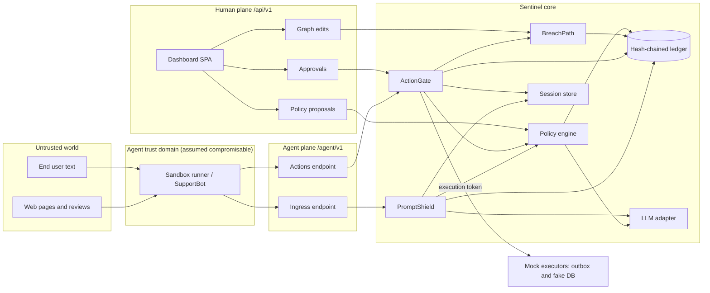
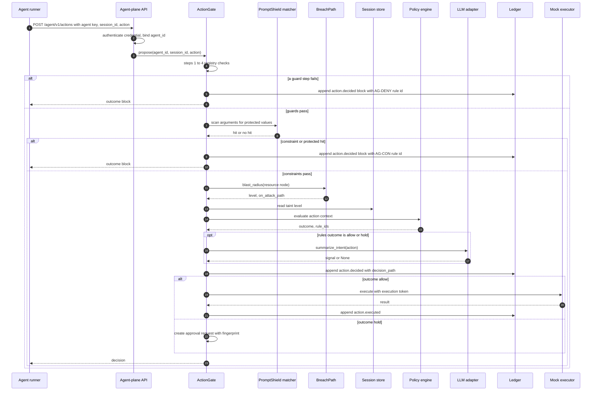
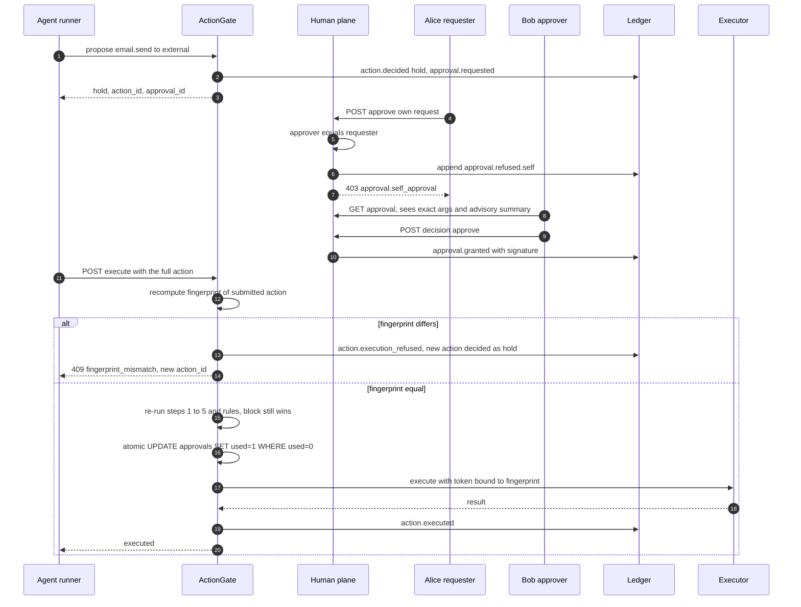
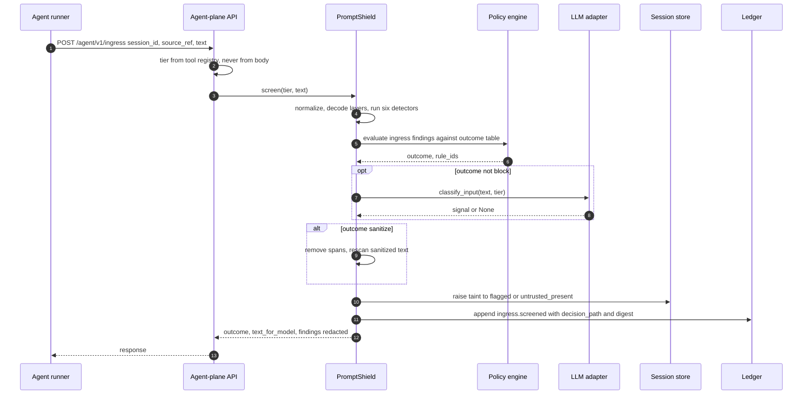
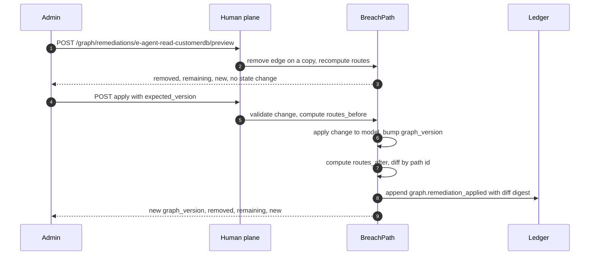
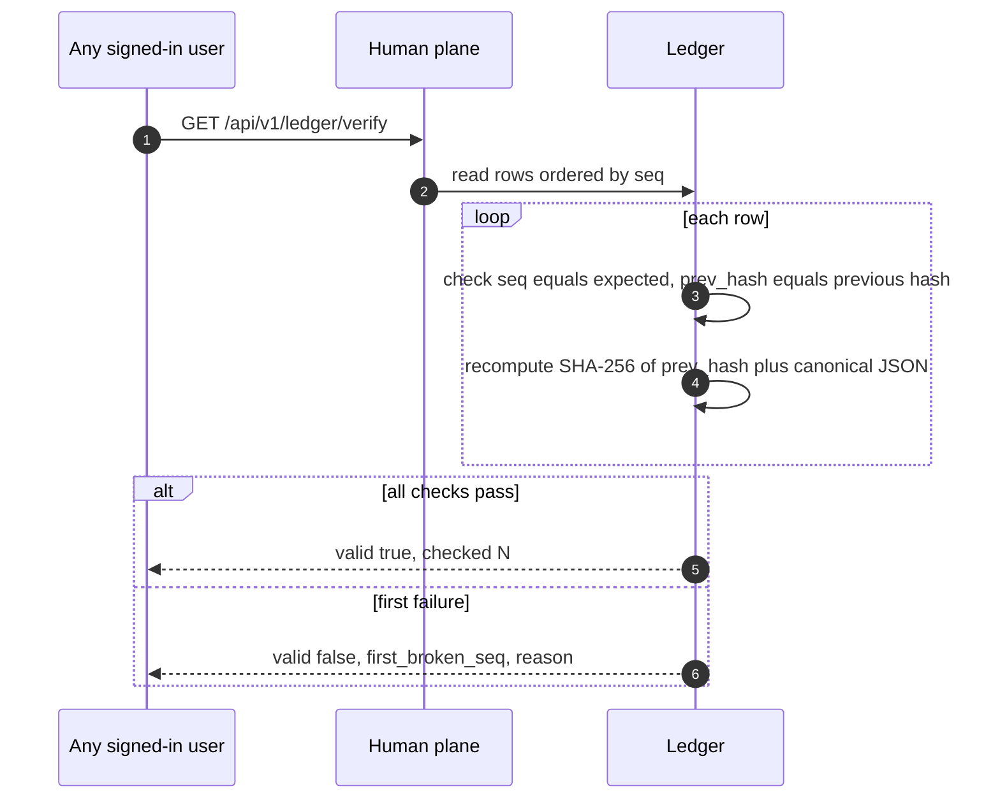
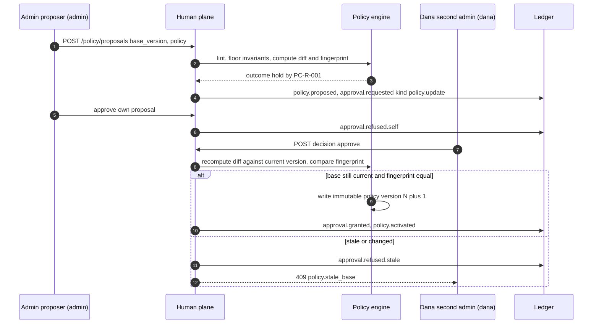
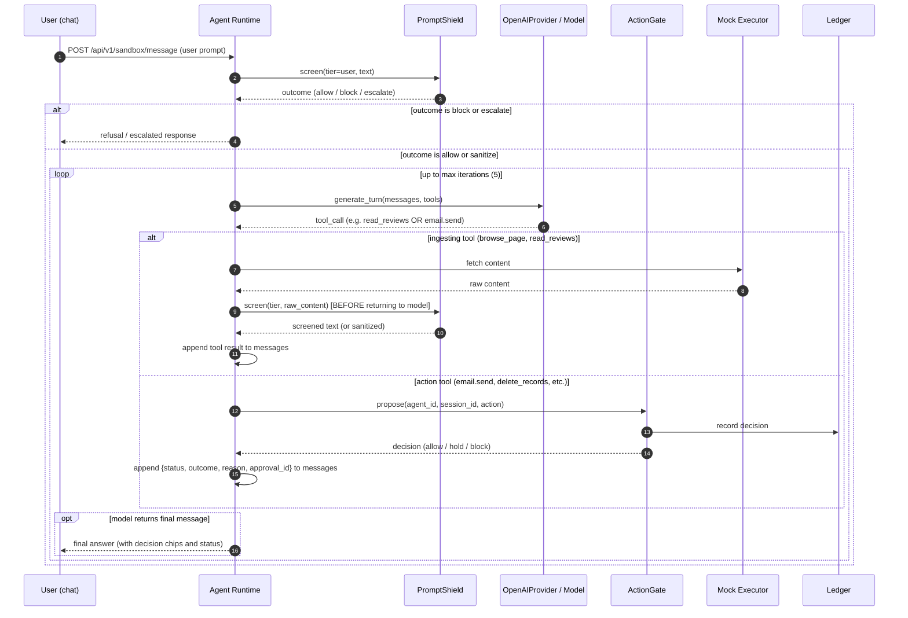
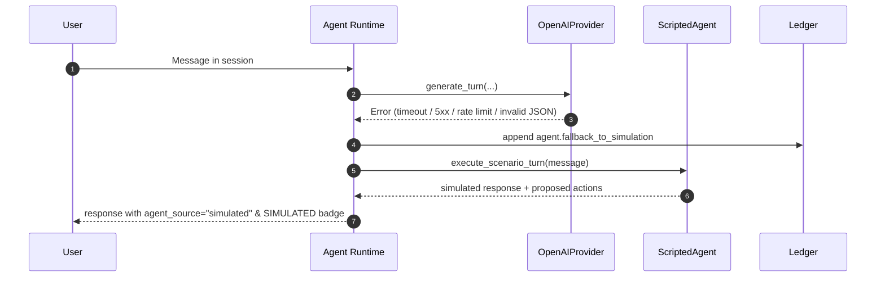

# Sentinel: Architecture

Components, trust boundaries, request flows, technology choices, deployment, and the consolidated decision log. Requirement IDs refer to `spec.md`. **MVP** = buildable by 3 to 4 people in a short hackathon window. **Stretch** = only after MVP is green.

## 1. System context

Sentinel is a security control plane around one simulated agent (`SupportBot` of Acme Retail). It has three modules and three shared components.

| Stage | Module | Package | Question |
| --- | --- | --- | --- |
| Before the model | PromptShield | `backend/app/promptshield` | Is this input manipulating the agent or leaking data? |
| After the model | ActionGate | `backend/app/actiongate` | Is this proposed action allowed, blocked, or held? |
| Around the model | BreachPath | `backend/app/breachpath` | If the agent is compromised, what can it reach? |

| Shared component | Package | Responsibility | IDs |
| --- | --- | --- | --- |
| Policy engine | `core/policy.py` | Deterministic evaluation, deny-overrides, versioning | PE-01..07 |
| Audit ledger | `core/ledger.py` | Hash-chained append-only log, verify | LG-01..07 |
| LLM provider & adapter | `core/llm.py`, `core/providers/` | Provider interface, OpenAIProvider, MockProvider, ScriptedAgent, circuit breaker, runtime modes | LA-01..10 |
| Agent runtime | `actiongate/runtime.py` | SupportBot function definitions, autonomous loop, tool interception, PromptShield pre-screening | AG-17..20 |
| Session store | `core/session.py` | Taint levels, monotonic taint | SS-01..04 |
| Auth & RBAC | `api/auth.py` | Two planes, role enforcement (requester, approver, admin), execution tokens | AU-01..07 |



## 2. Trust boundaries

| ID | Boundary | What crosses | Enforcement |
| --- | --- | --- | --- |
| TB1 | Content authors to agent | Review text, web pages, tool output | PromptShield screens by tier. Tier is set by the platform from the tool registry, never by content (PS-01). |
| TB2 | Agent to gateway | Ingress submissions, proposed actions | Agent-plane credential only. Agent identity comes from the credential, never the body (AU-01). Agent cannot create sessions (SS-04). |
| TB3 | Browser to human plane | Approvals, policy proposals, graph edits, LLM settings | Human token with roles. Agent credentials are rejected on every `/api/v1` route (AU-02). Server enforces role permissions on every route (AU-05). |
| TB4 | Gateway to executors | Execution token | Executors verify an HMAC token bound to action id and fingerprint. No token, no side effect (AU-04, AG-11). |
| TB5 | App to SQLite file | Ledger rows, policy versions | Triggers block UPDATE/DELETE as defense in depth. Tamper evidence relies on the hash chain, not on the triggers. An insider with file access is a stated adversary. |
| TB6 | App to Guard LLM (advisory) | Text to classify, action summaries | Output is untrusted: schema validated, timeout, circuit breaker, can only tighten (LA-01..04, LA-08). |
| TB7 | Sandbox runner inside the server process | Runner calls the agent plane over its own HTTP client | The runner holds only the agent key. It is code in the agent trust domain even though it shares a process. |
| TB8 | App to External LLM Provider (OpenAI) | Prompt messages, tool definitions, tool responses | API key held only in server env; model output treated as untrusted proposals; tool calls intercepted and gated; ingesting tool output screened by PromptShield before return to model (AG-18, AG-19). |

## 3. Two auth planes

| Property | Agent plane | Human plane |
| --- | --- | --- |
| URL prefix | `/agent/v1` | `/api/v1` |
| Credential | `Authorization: Bearer agk_<agent_id>_<secret>`. Stored as SHA-256(pepper + secret). | `Authorization: Bearer hum.<payload>.<sig>`. HMAC-SHA256 signed token holding `user_id`, `roles`, `exp`. |
| Signing key | `SENTINEL_AGENT_PEPPER` | `SENTINEL_HUMAN_KEY` |
| Can | Read own session taint, submit ingress, propose actions, execute approved actions, poll action status | Everything else: login, sessions, approvals, policy, graph, ledger, benchmark, tests, LLM mode/settings, taint reset |
| Cannot | Call any human route. Create or reset sessions. Approve. Edit policy or graph. | Call `/agent/v1`. Tokens fail there with `auth.wrong_plane`. |
| Human Roles | N/A | `requester` (Alice): chat, view own session requests. `approver` (Bob, Admin, Dana): decide actions & reviews. `admin` (Admin, Dana): manage policy, graph, LLM settings, test connection, benchmark, tests, tamper. |

A single FastAPI dependency per router (`require_agent`, `require_human(roles=...)`) is the only way to obtain a principal. Routers are mounted separately so a missing decorator on a human route fails closed: the default dependency on the `/api/v1` router is `require_human()`. Server-side role checks reject unauthorized callers with 403 `auth.forbidden_role`. Test T-AU-01 enumerates the OpenAPI route table and calls every human route with an agent key.

Other keys: `SENTINEL_APPROVAL_KEY` (approval signatures), `SENTINEL_EXEC_KEY` (execution tokens). Four distinct keys so one leak does not cross planes.

## 4. Request flows

### 4.1 Action proposal (AG-01..05, AG-08, AG-09, AG-12, AG-13)



### 4.2 Hold, approval, and execution (AG-06, AG-07, AG-14, AG-15, AG-16)



### 4.3 Ingress screening with taint (PS-01, PS-06, PS-07, PS-10)



### 4.4 Graph change with diff (BP-08, BP-09, BP-14, BP-17)



### 4.5 Ledger verification (LG-03)



### 4.5b Policy change gating (PE-06, X-07, AU-07)



### 4.6 Agent runtime autonomous loop with function calling (AG-17..20)



### 4.7 Auto-fallback to simulation on provider failure (LA-09)



## 5. Technology choices

| Area | Choice | Rationale |
| --- | --- | --- |
| Language and API | Python 3.11, FastAPI, Pydantic v2 | Fast to build, JSON Schema for free, OpenAPI feeds the route-table auth test |
| Storage | SQLite, WAL mode, single file | `make seed` resets by deleting the file. A single writer lock makes the ledger chain simple. |
| Graph | Small custom module, no NetworkX | Full control of cycles, reverse-traversal edge types, stable path IDs, caps, deterministic order |
| Frontend | React 18, Vite, Cytoscape.js | Required by brief |
| Tests | pytest with a `req` marker and a JSON reporter plugin | Feeds the Test Report screen (UI-09) |
| Live updates | Polling every 2 s (MVP). SSE at `/api/v1/stream` (Stretch). | Cut list item |
| Packaging | Docker Compose, one service, FastAPI serves the built SPA | One command start |
| LLM Provider Layer | OpenAI Python SDK (`openai>=1.0.0`), MockProvider for tests, ScriptedAgent for simulation | Supports structured outputs and function calling. Network-isolated tests using MockProvider. Replay determinism via ScriptedAgent. |

## 6. Concurrency, transactions, and fail-closed behavior

| Concern | Design |
| --- | --- | 
| Ledger appends | One process-wide lock plus `BEGIN IMMEDIATE`. Read last row, compute hash, insert, commit. 50 concurrent appends must yield contiguous seq (T-LG-08). |
| State plus ledger | Action row, approval row, session taint change, and the ledger entry are written in the same transaction. If the ledger insert fails the transaction rolls back, nothing executes, and the caller gets 503 `ledger.unavailable` (fail closed). |
| Execution after allow | Decision commits first. The executor runs after commit. Execution result is a second ledger entry. A crash between them leaves a decided-but-unexecuted action, which is safe. |
| Single-use approval | `UPDATE approvals SET used=1, used_at=? WHERE approval_id=? AND used=0 AND status='approved'`. Row count 1 means the caller won. |
| Policy loading | Active version is cached by version number. A missing or unparsable policy makes every decision `block` with rule `PE-ERR-NOPOLICY`. |
| Graph unavailable | `blast_radius` returns `level=high`. Reason recorded in signals. |
| Detector time | Each detector has a time budget (50 ms) and linear-time regexes only. On budget exhaustion the result is `escalate` for untrusted tiers, `block` for user tier, reason `PS-ERR-BUDGET`. |

## 7. Deployment

```yaml
# docker-compose.yml
services:
  sentinel:
    build: .
    ports: ["8000:8000"]
    environment:
      SENTINEL_DB: /app/data/sentinel.db
      SENTINEL_SEED: "1337"
      SENTINEL_DEMO_MODE: "1"          # enables /demo/* routes and quick switch
      SENTINEL_LLM_MODE: ok            # ok | says_safe_always | timeout | garbage | down
      OPENAI_API_KEY: ""               # optional: provider key for live LLM mode
      OPENAI_MODEL: gpt-4o-mini        # default model for agent & guard
      LLM_TIMEOUT_SECONDS: "3.0"       # timeout ceiling for provider calls
      SENTINEL_AGENT_MODE: simulation  # live | simulation
      SENTINEL_GUARD_MODE: live        # live | rules_only
      SENTINEL_HUMAN_KEY: demo-human-key-change-me
      SENTINEL_APPROVAL_KEY: demo-approval-key-change-me
      SENTINEL_EXEC_KEY: demo-exec-key-change-me
      SENTINEL_AGENT_PEPPER: demo-pepper-change-me
    volumes: ["./data:/app/data"]
    command: sh -c "python -m seed.seed --if-empty && uvicorn app.main:app --host 0.0.0.0 --port 8000"
```

| Make target | Action |
| --- | --- |
| `make up` | `docker compose up --build`, UI at http://localhost:8000 |
| `make seed` | Delete DB, rebuild every dataset with seed 1337 (SD-07) |
| `make test` | Run pytest, write `reports/last_run.json` for the Test Report screen |
| `make bench` | Run the PromptShield benchmark on the test split, write `reports/benchmark.json` |
| `make demo` | `make seed`, start the app, open the Sandbox |
| `make dev` | Backend with reload on 8000, Vite on 5173 with proxy |

Decision: `SENTINEL_DEMO_MODE` defaults to `0` outside Compose. With it off, `/api/v1/demo/*` returns 404 and the tamper button is hidden.

## 8. Performance budgets (checked in `test-plan.md` section 6)

| Operation | Target (p95, laptop, warm) |
| --- | --- |
| Action decision, rules path | 50 ms |
| Ingress screen, 10 KB text | 100 ms |
| Route search, 30 nodes, depth 4 | 100 ms. Hard caps 2000 ms and 1000 routes. |
| Ledger verify, 10 000 rows | 1 s |

## 9. Decision log

Every gap in the brief that required a choice. Each is also referenced where it applies.

| ID | Decision | Rationale |
| --- | --- | --- |
| D-01 | Planes split by URL prefix, credential type, and signing key. | Structural separation, testable by route table. |
| D-02 | Sessions are created only on the human plane by the requesting user. The agent cannot create or reset sessions. | Prevents session laundering (an agent escaping taint by opening a fresh session). |
| D-03 | The sandbox runner is server-side code that holds the agent key and calls the agent plane. The browser never holds the agent key. | Keeps the planes honest in the demo. |
| D-04 | `allow` executes immediately inside the propose call. `hold` executes only through a later `execute` call carrying the full action. | Makes TOCTOU and fingerprint binding testable. |
| D-05 | An approval is consumed at execution-token issuance. A fingerprint-mismatch attempt does not consume it. | Single use without letting a bad attempt burn a legitimate approval. |
| D-06 | The approval signature covers immutable fields. `used` and `status` live outside the signature. | `used` changes after signing. |
| D-07 | The LLM may tighten `allow` to `hold` (actions) and `allow` or `sanitize` to `escalate` (ingress). It never produces `block` and never loosens. | Limits LLM-induced denial of service. Block stays deterministic. |
| D-08 | `block` outcomes do not consult the LLM, so `decision_path = rules`. | No benefit from a signal. |
| D-09 | Seed a fourth user, `dana`, with role `admin`. | Policy changes need a different admin to approve and the brief lists only one Admin. |
| D-10 | Pipeline steps 1 to 5 short-circuit with fixed rule IDs. Step 7 evaluates all rules and unions matches. | Deterministic and explainable. |
| D-11 | A node is a sensitive target when `sensitivity >= settings.sensitive_min` (default `medium`). Routes end at the first sensitive node reached. | Bounds enumeration and makes "route to an asset" unambiguous. |
| D-12 | Edge types `ingests_from` and `trusts` are stored in natural phrasing (consumer to source) and traversed in reverse. All other types traverse forward. | Users enter `agent ingests_from tool` naturally, while the attacker moves from tool to agent. |
| D-13 | Graph models are stored as immutable JSON snapshots per `graph_version`. | Simple diffing and rollback. |
| D-14 | Blast radius levels: `high` if on an attack path and a high or critical asset is reachable. `medium` if on a path, or if a sensitive asset is reachable but the node is on no path. Otherwise `low`. Unknown node or unavailable graph gives `high`. | Fail safe and explicit. |
| D-15 | Remediation suggestions are `remove_edge` only. Ranked by routes broken, ties by edge ID ascending. | Deterministic, no invented edges. |
| D-16 | Source tier is assigned by the tool registry (`web.fetch` output is `retrieved_document`, `reviews.read` output is `tool_output`). The `developer` tier is never accepted by the agent-plane API (422). | Tier must not come from content or agent claims. |
| D-17 | Ingress `escalate` withholds the text from the model and creates an `ingress_review` item in the Approvals queue. | Gives `escalate` real meaning. |
| D-18 | If sanitizing leaves fewer than 8 alphanumeric characters, the outcome is upgraded to `block` (`PS-SAN-EMPTY`). | Sanitize must preserve legitimate content. |
| D-19 | Framing discounts (quoted, descriptive text) never apply to protected-value findings, and never push an exfil finding with an instruction and external destination below 45. | Stops "for example: ..." wrappers from bypassing detection. |
| D-20 | Confidences are integers 0 to 100 everywhere. | Canonical JSON hashing without float ambiguity. |
| D-21 | Demo attacker address is `attacker@evil.example`. Internal domain is `acme.example`. | Reserved TLD, no real domain involved. |
| D-22 | Canary values live in `customers.internal_notes` and a system-prompt marker. Mock executors never return that column. The demo export therefore holds no canary. | Lets step 4 end in `hold`, and the egress test (X-05) use an explicit canary. |
| D-23 | Canonical JSON: sorted keys, separators `,` and `:`, `ensure_ascii=False`, UTF-8, no floats. | One definition for ledger and fingerprints. |
| D-24 | Ledger payloads (redacted) live in `ledger_payloads`. Entries carry `payload_ref` and `payload_digest`. | Keeps hashed rows small. |
| D-25 | Human auth is demo-grade: seeded users, password `demo`, signed tokens. | Production auth is a non-goal. |
| D-26 | Ledger write failure fails closed (503, nothing executes). | Evidence over claims. |
| D-27 | At execute time the gateway re-runs steps 1 to 5 and rules. A `block` result refuses the execution. A `hold` result is satisfied by the valid approval. | Policy tightening between approval and execution takes effect. |
| D-28 | Rates are reported with Wilson 95% intervals. | Small samples must not look precise. |
| D-29 | Mock LLM mode `ok` answers from a fixtures file keyed by SHA-256 of the input, with a keyword heuristic for unknown inputs. | Replay determinism. |
| D-30 | When the LLM fails, rules-only decides, including `allow`. No extra tightening on fallback in the MVP. Setting `settings.llm.on_failure: hold_allow` (Stretch) would hold every would-be allow. | The LLM can only tighten, so the rules-only result is by definition the safe baseline. |

## 10. MVP and Stretch by component

| Component | MVP | Stretch |
| --- | --- | --- |
| Core | Policy engine, ledger and verify, mock LLM with five modes, taint | Ledger checkpoint export (LG-06), real LLM provider |
| ActionGate | Registries, nine-step pipeline, fingerprint approvals, executors | None |
| BreachPath | JSON upload, validation, search, explanations, remediation, diff, blast radius, derived entry points | CSV upload (BP-16), observed-vs-declared (BP-13), edit form |
| PromptShield | Six detectors, outcome table, sanitize, benchmark | LLM classifier on a real provider |
| Dashboard | Sandbox, Approvals, Attack Graph, Audit, Benchmark, Live Decisions, Lab, Policy Editor, Test Report | SSE |
