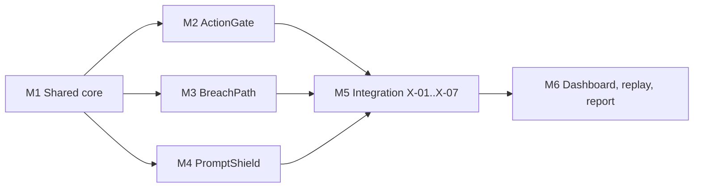

# Sentinel: Roadmap

Milestones, task breakdown, build order, and cut list. Plan for **4 people** over a hackathon-style window of about 2 days (roughly 40 focused hours each, so the plan is tight and the cut list is expected to be used). With 3 people, merge roles C and D's UI work into A and B and apply the cut list early. Requirement IDs refer to `spec.md`. Estimates are person-hours and include tests.

## 1. Roles

| Role | Owner of | Also |
| --- | --- | --- |
| **A. Core and integration** | Policy engine, ledger, LLM adapter, session, auth, X-links, E2E replay | Test harness and Test Report plumbing |
| **B. ActionGate** | Registries, pipeline, approvals, executors, Approvals and Sandbox screens | Fault-injection tests |
| **C. BreachPath** | Validation, search, remediation, diff, blast radius, Attack Graph screen | Seed graph |
| **D. PromptShield** | Detectors, outcome logic, sanitize, benchmark, Lab and Benchmark screens | Seed reviews and benchmark data |

Shared: app shell, Audit Ledger, Live Decisions, Policy Editor (A), docs upkeep (everyone, 15 minutes per milestone).

## 2. Build order and dependencies

M2, M3, and M4 run in parallel after M1's interfaces exist. M1 publishes **stubs first** (interfaces with in-memory fakes) in the first 2 hours so B, C, and D are never blocked: `Ledger.append`, `PolicyEngine.evaluate`, `LLM.classify_input/summarize_intent`, `Session.raise_taint`, `blast_radius` (stub returning `high`), `protected_scan` (stub returning no hit).

## 3. Milestones

### M1. Shared core (A, with help from B on auth). Total about 26 h

| Task | IDs | Est. | Done when |
| --- | --- | --- | --- |
| M1.1 Repo, FastAPI skeleton, SQLite schema and triggers, Makefile, Compose | | 3 | `make up` serves `/health` |
| M1.2 Canonical JSON, clock, ID counters | D-23 | 1 | Vectors in `data-models.md` section 4 pass |
| M1.3 Ledger append and verify, redaction pass | LG-01..05, LG-07 | 5 | T-LG-01..08 green |
| M1.4 Policy engine: conditions, deny-overrides, default, versioning, lint | PE-01..05, PE-07 | 6 | T-PE-01..05, 07 green. `seed/policy_v1.yaml` loads |
| M1.5 LLM adapter: schemas, timeout, breaker, mock with five modes and fixtures | LA-01..05 | 4 | T-LA-01..05 green |
| M1.6 Session store and taint, human-only reset | SS-01..04 | 2 | T-SS-01..04 green |
| M1.7 Auth: two planes, roles, tokens, agent keys, execution tokens | AU-01..04 | 5 | T-AU-01..04 green (route-table test needs routes from other milestones, finish in M5) |

### M2. ActionGate (B). Total about 28 h

| Task | IDs | Est. | Done when |
| --- | --- | --- | --- |
| M2.1 Registries and seed data (agents, six action types, schemas) | AG-01, AG-02, SD-04 | 3 | T-AG-01, 02 green |
| M2.2 Pipeline steps 1 to 5: schema, constraints, protected-value scan hook | AG-03, AG-04 | 5 | T-AG-03, 04 |
| M2.3 Context building: impact factors, destination classification, record counts | AG-04, AG-05 | 3 | Worked decisions 1 to 16 in `policy-spec.md` section 7 pass (with stubbed blast) |
| M2.4 Rule evaluation, LLM merge (tighten only), decision record, ledger | AG-08..10, AG-12, AG-13 | 4 | T-AG-08..10 |
| M2.5 Fingerprints, approvals, state machine, signatures, self-approval, execute checks | AG-06, AG-07, AG-14..16 | 8 | T-AG-06, 07, 14..16 |
| M2.6 Mock executors, outbox, fake DB, token verification | AG-11 | 3 | T-AG-11, T-AU-04 |
| M2.7 Agent-plane endpoints | | 2 | `api.md` section 1 examples pass |

### M3. BreachPath (C). Total about 30 h

| Task | IDs | Est. | Done when |
| --- | --- | --- | --- |
| M3.1 Model, JSON Schema, referential validation, error codes, limits | BP-01, BP-02, BP-15 | 5 | T-BP-01, 02, 15 |
| M3.2 Adjacency with edge-type traversal metadata, DFS with caps, path IDs | BP-03, BP-04, BP-10, BP-18 | 6 | T-BP-03, 04, 10, 17, 18. Seed counts 0, 2, 6, 7, 8 |
| M3.3 Steps and explanation templates | BP-05, BP-06 | 3 | T-BP-05, 06 |
| M3.4 Remediation: candidates, ranking, greedy plan, preview | BP-07, BP-08 | 4 | T-BP-07, 08 |
| M3.5 Change API, versioning, diff, ledger | BP-09, BP-14, BP-17 | 5 | T-BP-09, 14 |
| M3.6 Blast radius and derive entry points | BP-11, BP-12 | 4 | T-BP-11, 12 |
| M3.7 Seed `graph.json`, `bad_graph.json`, expected values | SD-02 | 3 | T-SD-01 graph part |

### M4. PromptShield (D). Total about 35 h

| Task | IDs | Est. | Done when |
| --- | --- | --- | --- |
| M4.1 Normalization, index maps, decoders (base64, hex, percent, tags) | PS-05 | 5 | Variant table in `seed-data.md` section 1 caught |
| M4.2 Detectors D1 to D3 with scoring and framing logic | PS-02..04, PS-13 | 8 | T-PS-02..04, 13 on dev |
| M4.3 Detectors D4 to D6 | PS-05, PS-11, PS-12 | 6 | T-PS-05, 11, 12 |
| M4.4 Outcome logic, table, thresholds, sanitize, rescan, taint | PS-01, PS-06, PS-07, PS-10 | 5 | T-PS-01, 06, 07, 10 |
| M4.5 Escalation queue, LLM tightening, resource bounds | PS-14..16 | 3 | T-PS-14..16 |
| M4.6 Seed reviews, benchmark file (80 cases), loader, metrics with Wilson intervals, miss table | PS-08, SD-03, SD-06 | 7 | T-PS-08, 17, T-SD-02. `make bench` writes the report |
| M4.7 Content cannot alter policy (static import test) | PS-09 | 1 | T-PS-09 |

### M5. Integration (A leads, all join). Total about 14 h

| Task | IDs | Est. | Done when |
| --- | --- | --- | --- |
| M5.1 Replace stubs: real blast radius, real protected scan, real taint reads | X-01, X-02, X-05 | 3 | T-AG-12, 13, T-X-05 |
| M5.2 Derived entry points on seed and registry change | X-03 | 1 | T-X-03 |
| M5.3 Gated policy proposals and approvals for `policy.update` | PE-06, X-07 | 4 | T-PE-06 |
| M5.4 One ledger and one policy across modules, verify across all | X-06 | 1 | T-X-06 |
| M5.5 Full route-table auth test, ledger refusal matrix | AU-01, LG-05 | 2 | T-AU-01, T-LG-07 |
| M5.6 Sandbox runner, scripted replay engine | DEMO-01, DEMO-02 | 3 | T-E2E-01 passes headless |

### M6. Dashboard, demo, report (all). Total about 37 h

Parallel by screen owner. Build order from the brief.

| Task | Screen | Owner | Est. | Done when |
| --- | --- | --- | --- | --- |
| M6.1 Shell, user switcher, LLM toggle, error and loading patterns | UI-10 | A | 3 | Switch users, flip LLM |
| M6.2 Agent Sandbox and replay bar | UI-01 | B | 5 | Replay runs S1..S8 visibly |
| M6.3 Approvals | UI-03 | B | 3 | Step S5 works with real refusal |
| M6.4 Attack Graph, remediation, diff panel | UI-04 | C | 8 | Steps S1 and S6 match expected |
| M6.5 Audit Ledger with Verify and Tamper | UI-08 | A | 3 | Step S8 |
| M6.6 Benchmark | UI-06 | D | 3 | Tables with misses and FPs |
| M6.7 Live Decisions, Lab | UI-02, UI-05 | D | 3 | Feed updates every 2 s |
| M6.8 Policy Editor | UI-07 | A | 3 | Proposal creates pending approval |
| M6.9 Test Report plugin and screen | UI-09 | A | 2 | Grouped by requirement ID |
| M6.10 Demo rehearsal x3, fix mismatches, README polish | DEMO-03 | all | 4 | Under 5 minutes, identical outcomes |

**Total about 170 person-hours** (about 42 per person). Stretch items are excluded.

## 4. Suggested schedule (2 days, 4 people)

| Block | A | B | C | D |
| --- | --- | --- | --- | --- |
| Day 1 h0 to 2 | M1.1, stubs | M2.1 | M3.1 | M4.1 |
| Day 1 h2 to 8 | M1.2 to M1.7 | M2.2 to M2.5 | M3.2 to M3.5 | M4.2, M4.3 |
| Day 1 h8 to 12 | M1 wrap-up, M6.1 | M2.5 to M2.7 | M3.6, M3.7 | M4.4, M4.5 |
| Day 2 h0 to 4 | M5.1 to M5.4 | M5.6 | M6.4 start | M4.6 |
| Day 2 h4 to 8 | M5.5, M6.5, M6.8, M6.9 | M6.2, M6.3 | M6.4 | M6.6, M6.7 |
| Day 2 h8 to 12 | M6.10 rehearsal, fix | same | same | same |

Checkpoints: end of Day 1 h6, all three modules pass their unit tests against stubs. End of Day 2 h4, `T-E2E-01` passes headless. End of Day 2 h8, UI complete, rehearsals begin.

## 5. Cut list (cut in this order if time runs short)

| Order | Cut | Impact | Keeps working |
| --- | --- | --- | --- |
| 1 | CSV upload (BP-16) | None for the demo | JSON upload |
| 2 | Detectors beyond the six | None, six are specified | D1 to D6 |
| 3 | SSE (use polling) | Slightly slower UI | Polling at 2 s |
| 4 | Ledger checkpoint export (LG-06) | Truncation limit stays documented only | Verify |
| 5 | Observed-vs-declared (BP-13, X-04) | One report screen missing | All other links |
| 6 | Graph editing form (UI) | Changes through API and upload | Upload, remediation apply, change API |
| 7 | Benchmark rules-plus-LLM comparison tab | Rules-only report only | PS-08 |
| 8 | Policy Editor structured form (keep raw YAML edit with lint and propose) | Rougher editor | PE-06, X-07 |
| 9 | Playwright smoke (keep manual checklist) | Less UI regression safety | API and replay tests |

**Never cut:** tests, ledger verification, LLM fallback path, approval binding, cycle handling, diff logic. Also never cut: two-plane auth, self-approval refusal, the held-out benchmark discipline, and the miss list.

## 6. Stretch backlog (only after MVP exit criteria)

1. LG-06 checkpoint export and tail-truncation verification.
2. BP-13 observed-vs-declared report and X-04.
3. BP-16 CSV upload and the graph edit form.
4. Real LLM provider behind the adapter interface, with the same schemas, timeout, and breaker.
5. SSE live updates.
6. Keyed (HMAC) ledger chain with the key held off-host, to resist full-table rewrites.
7. `settings.llm.on_failure: hold_allow`.
8. ROT13 and leetspeak decoders (benchmark known-hard cases).

## 7. Risks and mitigations

| Risk | Likelihood | Mitigation |
| --- | --- | --- |
| Detector tuning eats time | High | Cap M4.2 and M4.3 at 14 h total. Report misses honestly rather than chase them. Dev split only. |
| Frontend graph work overruns | Medium | Use Cytoscape's default layouts and styles first, polish after S1 and S6 pass |
| Integration surprises in M5 | Medium | Stubs with the final interfaces in M1, contract tests per interface |
| Nondeterminism in replay | Medium | Injected clock, counters, fixtures, no random in engines. T-E2E-02 runs twice. |
| Scope creep | High | Brief is the source. New features go to the stretch backlog or are refused. |
| Hash or fingerprint implementation drift | Low | Test vectors in `data-models.md` section 4 gate M1.2 |

## 8. Definition of done (MVP)

1. All non-Stretch tests, fault-injection tests, `T-E2E-01`, and `T-E2E-02` green.
2. `make bench` produces a report with a non-empty miss list and a false-positive table.
3. The 8-step replay completes in under 5 minutes of human pacing with every step matching.
4. `GET /ledger/verify` is valid after the replay and red at the right `seq` after the tamper step.
5. Test Report screen shows zero requirements without a passing test.
6. `README.md` quick start works from a clean checkout with one command.
